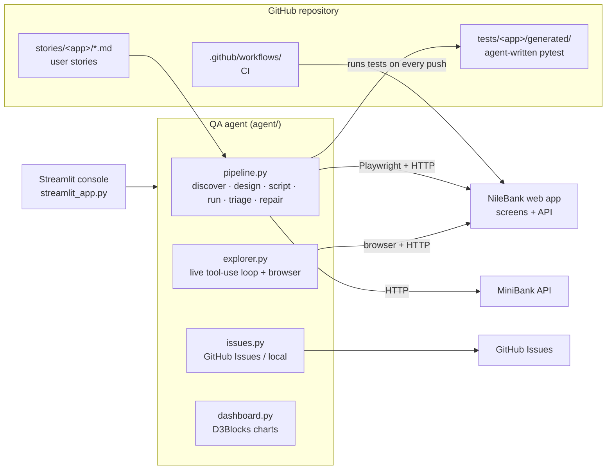
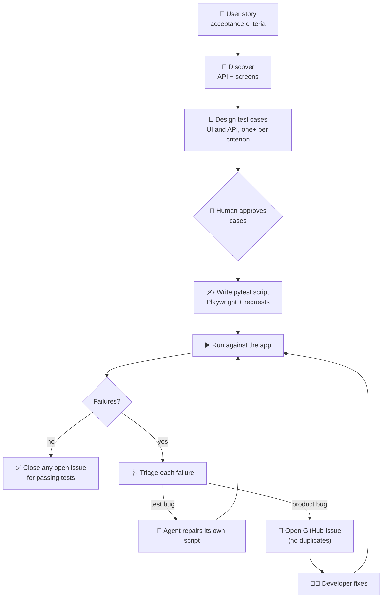

# 🧪 Agentic Testing Lab

A hands-on lab where an AI agent does the QA job end to end:

> **reads a user story → discovers the app (API and screens) → designs test cases → writes the test scripts
> (Playwright UI + API) → runs them → triages failures → repairs its own broken tests → files GitHub Issues
> → closes them when the fix lands.**

It also has an **exploratory mode**, where the agent tests the live app itself, driving a real browser and the API
one action at a time, deciding what to try next from what it sees.

No Jira, no testing background needed. Runs free in **demo mode** (no API key), or with **Claude** as the brain.

## Two applications under test

| App | What it is | Stories | Seeded bugs |
|---|---|---|---|
| **NileBank** (`apps/nilebank/`) | A realistic online-banking **web app**: sign-in with lockout, accounts overview, own and beneficiary transfers with a daily limit, beneficiaries with IBAN validation, paginated history, sign-out. Web screens (with `data-testid`s for automation), REST API, SQLite database. | 7 | 8 (UI, API and security) |
| **MiniBank** (`app_under_test/`) | A tiny core-banking **REST API**, the simplest possible starting point. | 3 | 3 |

Both run a **buggy** build by default; `NILEBANK_FIXED=1` / `MINIBANK_FIXED=1` (or the *Developer fix deployed*
toggle) runs the build where developers shipped the fixes. NileBank test users: `amira` / `Nile@2026`,
`omar` / `Pyramid#77`.

The agent treats both as **black boxes**: it only uses their URL, `/openapi.json` and the screens. The app code
sits in the same repo for convenience, but it could live in its own repo and be tested through **External URL**.

---

## What's inside



| Part | What it is |
|---|---|
| `apps/nilebank/` | NileBank: `app.py` (FastAPI, API + web pages, seeded bugs), `templates/`, `static/`. |
| `app_under_test/minibank.py` | MiniBank. |
| `stories/nilebank/`, `stories/minibank/` | User stories with acceptance criteria. They replace Jira tickets: add a `.md` file and the agent picks it up. |
| `agent/config.py` | The registry of applications under test (`TARGETS`): how to start, check, reset and reach each one. |
| `agent/target.py` | Starts apps, reads `/openapi.json`, and **crawls the screens** of web apps to build a map of every field, button and link (`data-testid`s). |
| `agent/pipeline.py` | The cycle. Web apps get a mix of Playwright UI tests and API tests. |
| `agent/explorer.py` | Exploratory testing: HTTP tool, plus a real browser (open, type, choose, click, read the screen) with screenshots. |
| `agent/issues.py` · `agent/dashboard.py` | GitHub Issues (or a local file) · the D3Blocks QA dashboard. |
| `agent/demo_*.py`, `agent/demo_scripts/` | What the free demo brain "thinks" and "writes". |
| `tests/nilebank/conftest.py`, `nilebank_helpers.py` | The test toolkit: `bank` / `amira` API clients, Playwright `page` / `signed_in` fixtures, `sign_in()`, `money()`. |
| `tests/<app>/generated/` | Scripts written by the agent. Commit them; CI runs them forever after. |
| `streamlit_app.py` | The console. |
| `.github/workflows/` | `regression.yml` runs every test on each push; `agent-cycle.yml` runs the whole agent on demand or on a schedule. |

---

## The cycle



**Why triage matters:** a red test does not always mean the app is broken. The agent decides whether the
**app** contradicts the story (product bug, file an issue) or its **own script** is wrong (test bug, repair and
re-run). Demo mode plants one test bug in NileBank STORY-104 (a UI test clicks a button id that does not exist on
the screen) and one in MiniBank STORY-003, so you can watch the agent catch and fix its own mistakes.

**Who runs the tests?** The agent *writes* the tests, and **pytest/CI runs them**: deterministic, repeatable
and free. The agent adds the intelligence before (discovery, design) and after (triage, repair, issues). **Explore
live** is where the agent itself clicks through the app: good for hunting new bugs, not for regression.

---

## Quick start (local)

```bash
git clone https://github.com/<you>/agentic-testing-lab.git
cd agentic-testing-lab
python -m venv .venv && source .venv/bin/activate      # Windows: .venv\Scripts\activate
pip install -r requirements.txt
python -m playwright install chromium                  # once: the browser for UI tests
streamlit run streamlit_app.py
```

The console starts the selected app for you (sidebar → **Application**). With **NileBank** selected:

1. Click **Open the app ↗** in the sidebar and look around as a customer (`amira` / `Nile@2026`). Can you spot the
   wrong total on the accounts page?
2. Pick **STORY-104: daily limit**, open **⚡ Full cycle**, click **Run full cycle**. The agent discovers the
   screens, runs UI and API tests, **repairs its own broken UI test**, then files two bugs about the daily limit.
3. Open **📋 Issues board**: the bugs are there.
4. In the sidebar, switch on **Developer fix deployed**, then run the full cycle again: the tests pass and the agent
   **closes the issues**.
5. Pick **STORY-105** and try **🤖 Explore live**: the agent drives the browser, adds a beneficiary with a broken IBAN
   and HTML in the nickname, and records both bugs, with screenshots.
6. **📊 Dashboard** → **Seed demo history** to see the whole picture.

Command line, same thing:

```bash
python -m agent.cli cycle   --app nilebank --story ALL --demo --start-app           # buggy build: opens issues
python -m agent.cli cycle   --app nilebank --story ALL --demo --start-app --fixed   # fixed build: closes them
python -m agent.cli explore --app nilebank --story STORY-105 --demo --start-app
python -m agent.cli cycle   --app minibank --story ALL --demo --start-app
```

Watch the UI tests run in a visible browser: set `HEADED=1` before running `pytest tests/nilebank`.

### Use Claude as the brain

Choose **Claude API** in the sidebar and paste your Anthropic API key, or put it in `.streamlit/secrets.toml`
(see `secrets.toml.example`). Claude then really designs the cases from the story and the discovered screens,
writes the Playwright and API code, triages, repairs, and in Explore mode drives the browser through a tool-use
loop. Write your own story in `stories/nilebank/` and see what it does.

---

## GitHub setup (Issues instead of Jira)

1. **Create the repo** and push this folder.
2. **Bug tracker from the console:** create a fine-grained token (GitHub → Settings → Developer settings →
   Fine-grained tokens) for this repo only, with **Issues: Read and write**. In the sidebar choose
   **GitHub Issues**, enter `owner/repo` and the token.
3. **CI (no extra token needed, Actions uses its own):**
   - *Settings → Actions → General → Workflow permissions*: **Read and write**, and tick
     **Allow GitHub Actions to create and approve pull requests**.
   - Optional secret `ANTHROPIC_API_KEY` (Settings → Secrets and variables → Actions). Without it, CI runs in demo mode.
   - Optional variables `NILEBANK_FIXED=1` / `MINIBANK_FIXED=1` to simulate the developer fix in CI.
4. **Run it:** Actions → **QA agent cycle** → *Run workflow* → choose the app. It files issues, uploads the
   reports and the dashboard, and opens a **pull request with the generated tests**: that PR review is your human
   gate. Once merged, **Regression tests** runs them (UI and API, both apps) on every push.

> Note: pull requests opened with the built-in `GITHUB_TOKEN` don't trigger other workflows automatically.
> Close and reopen the PR, or push a commit to it, to start the regression run.

---

## Deploy the console (Streamlit Community Cloud)

1. Go to share.streamlit.io → **New app** → pick your repo, branch `main`, file `streamlit_app.py`.
2. In **Advanced settings → Secrets**, paste the contents of `secrets.toml.example` with your values (all optional).
3. Deploy. The apps start inside the same container. UI tests need Chromium: add a `packages.txt` with
   `chromium` or run the console where `playwright install chromium` has been done; API tests and MiniBank work
   everywhere.

---

## 📊 QA dashboard (D3Blocks)

Every agent run is recorded in `reports/history.jsonl`. The dashboard turns one app's history into interactive
D3 charts with [D3Blocks](https://github.com/d3blocks/d3blocks): **Sankey** (story → acceptance criterion →
outcome), **timeseries** (passed vs failed per cycle) next to the **open bugs**, **treemap** (test portfolio, green =
passed, red = product bug) and **tree** (traceability down to each test).

```bash
python -m agent.dashboard --app nilebank --seed   # first time: buggy → fix → regression demo cycles, then build
python -m agent.dashboard --app nilebank          # later: rebuild from the runs you made
```

Open `dashboard/<app>/index.html` in any browser: it is **one self-contained file** you can attach to an email,
with no server and no internet needed. In the console, use the **📊 Dashboard** tab.

Two adjustments to D3Blocks defaults, made on purpose:
- **No ads:** D3Blocks embeds an advertising script by default; the dashboard passes `support=False`,
  so the pages make zero external requests (important for bank and government networks).
- **Honest lines:** the timeseries smooths lines by default, which invents values between runs; the
  dashboard draws straight segments between the real data points instead.

---

## The seeded bugs (spoilers)

<details>
<summary>Click to reveal</summary>

**NileBank**

| Story | Bug | Seen in | Found by |
|---|---|---|---|
| STORY-101 AC3 | No lockout: unlimited password guesses | API + UI | TC-101-03, explorer |
| STORY-102 AC3 | "Total balance" only counts the first account (25,000 instead of 125,000) | UI only | TC-102-03, explorer |
| STORY-104 AC2 | Daily beneficiary limit checked per transfer, not per day | API + UI | TC-104-02, TC-104-04, explorer |
| STORY-105 AC2 | IBAN length never checked (`EG123` accepted) | API + UI | TC-105-02, explorer |
| STORY-105 AC4 | Nickname rendered as HTML: stored XSS | UI only | TC-105-04, explorer |
| STORY-106 AC2 | Pagination off by one: each page repeats a transaction | API + UI | TC-106-02, explorer |
| STORY-107 AC3 | Sign-out does not end the session on the server: the token keeps working | API only | TC-107-03, explorer |

STORY-103 (own transfers) has no bugs on purpose: an all-green run is a result too.

**MiniBank**

| Story | Bug | Found by |
|---|---|---|
| STORY-002 AC2 | Negative deposits are accepted and silently reduce the balance | TC-002-02, explorer |
| STORY-002 AC5 | Balances are not rounded: 0.10 + 0.20 = 0.30000000000000004 | TC-002-06, explorer |
| STORY-003 AC2 | Transfers ignore the balance: accounts can go negative (overdraft) | TC-003-02, explorer |
</details>

---

## Where to take it next

- **Split the repos:** move `apps/nilebank/` to its own repo and point the agent at its deployed URL.
- **Jira later:** swap `issues.py` for Jira's REST API, or connect Atlassian's MCP server to Claude Code.
- **Claude Code in GitHub Actions:** let developers type `@claude` on an issue the agent opened and ask for a fix PR.
- **Measure it:** track how many generated cases humans approve unchanged and how often triage is right.
