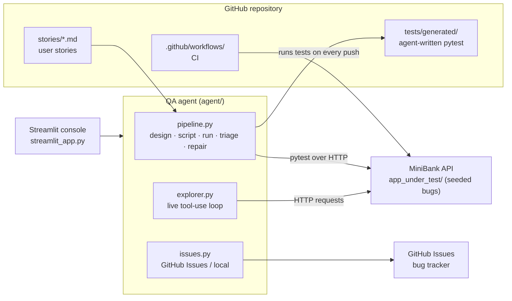
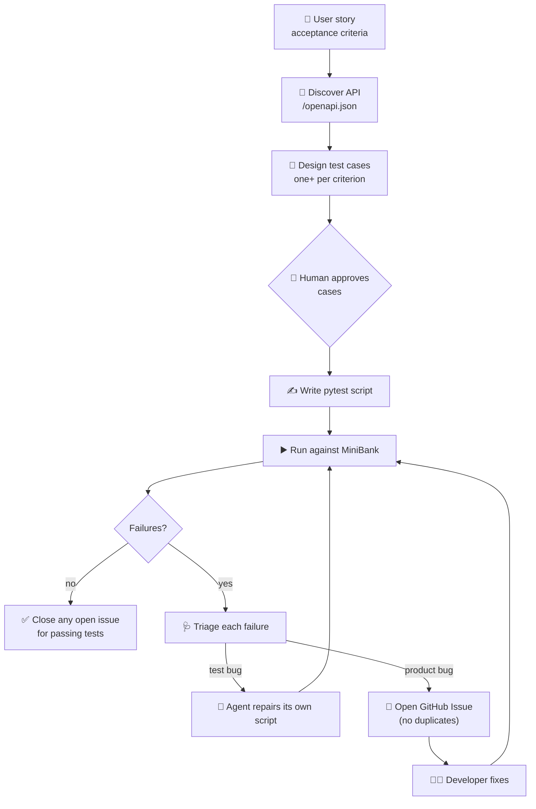

# 🧪 Agentic Testing Lab

A hands-on lab where an AI agent does the QA job end to end on a small banking API:

> **reads a user story → designs test cases → writes the test scripts → runs them → triages failures
> → repairs its own broken tests → files GitHub Issues → closes them when the fix lands.**

It also has an **exploratory mode**, where the agent tests the live app itself, one HTTP request at a time,
deciding what to try next from what it sees.

No Jira, no testing background needed. Runs free in **demo mode** (no API key), or with **Claude** as the brain.

---

## What's inside



| Part | What it is |
|---|---|
| `app_under_test/minibank.py` | **MiniBank**, a tiny core-banking REST API (FastAPI): accounts, deposits, withdrawals, transfers. Ships with **3 hidden bugs**. Set `MINIBANK_FIXED=1` to run the "fixed" build. |
| `stories/` | User stories with acceptance criteria. They replace Jira tickets: add a `.md` file and the agent picks it up. |
| `agent/` | The QA agent. `pipeline.py` = the cycle, `explorer.py` = live exploratory testing, `issues.py` = GitHub Issues, `llm.py` = Claude or demo brain. |
| `tests/conftest.py` | The `api` fixture the generated tests use (black box: HTTP only). |
| `tests/generated/` | Scripts written by the agent. Commit them; CI runs them forever after. |
| `streamlit_app.py` | The console: drive each step with human approval, run the full cycle in one click, or watch the agent explore. |
| `.github/workflows/` | `regression.yml` runs the tests on every push; `agent-cycle.yml` runs the whole agent on demand or on a schedule. |

---

## The cycle



**Why triage matters:** a red test does not always mean the app is broken. The agent decides whether the
**app** contradicts the story (product bug, file an issue) or its **own script** is wrong (test bug, repair and re-run).
Demo mode includes one deliberate test bug in STORY-003 so you can watch this happen.

**Who runs the tests?** The agent *writes* the tests, and **pytest/CI runs them**: deterministic, repeatable
and free. The agent adds the intelligence before (design) and after (triage, repair, issues). The **Explore live**
mode is where the agent itself clicks around (here, sends HTTP requests), which is good for hunting new bugs,
not for regression.

---

## Quick start (5 minutes, local)

```bash
git clone https://github.com/<you>/agentic-testing-lab.git
cd agentic-testing-lab
python -m venv .venv && source .venv/bin/activate      # Windows: .venv\Scripts\activate
pip install -r requirements.txt
streamlit run streamlit_app.py
```

The console starts MiniBank for you. Then:

1. Pick **STORY-003: Transfer money**, open **⚡ Full cycle**, click **Run full cycle**.
   You'll see the agent repair its own test, then file a bug: *transfers can overdraw an account*.
2. Open **📋 Issues board**: the bug is there.
3. In the sidebar, switch on **Developer fix deployed**, then run the full cycle again. The test passes and the agent **closes the issue**.
4. Try **🤖 Explore live** on STORY-002 and watch it find the negative-deposit and rounding bugs on its own.

Command line, same thing:

```bash
python -m agent.cli cycle --story ALL --demo --start-app            # buggy build: opens issues
python -m agent.cli cycle --story ALL --demo --start-app --fixed    # fixed build: closes them
python -m agent.cli explore --story STORY-003 --demo --start-app
```

### Use Claude as the brain

Choose **Claude API** in the sidebar and paste your Anthropic API key, or put it in `.streamlit/secrets.toml`
(see `secrets.toml.example`). Claude then really designs the cases, writes the code, triages, and in
Explore mode drives the app through a tool-use loop. Write your own story in `stories/` and see what it does.

---

## GitHub setup (Issues instead of Jira)

1. **Create the repo** and push this folder.
2. **Bug tracker from the console:** create a fine-grained token (GitHub → Settings → Developer settings →
   Fine-grained tokens) for this repo only, with **Issues: Read and write**. In the sidebar choose
   **GitHub Issues**, enter `owner/repo` and the token.
3. **CI (no extra token needed, Actions uses its own):**
   - *Settings → Actions → General → Workflow permissions*: **Read and write**, and tick
     **Allow GitHub Actions to create and approve pull requests**.
   - Optional secret `ANTHROPIC_API_KEY` (Settings → Secrets and variables → Actions). Without it, CI runs in demo mode.
   - Optional variable `MINIBANK_FIXED=1` to simulate the developer fix in CI.
4. **Run it:** Actions → **QA agent cycle** → *Run workflow*. It files issues, uploads a report
   (also shown on the run's summary page), and opens a **pull request with the generated tests**:
   that PR review is your human gate. Once merged, **Regression tests** runs them on every push.

> Note: pull requests opened with the built-in `GITHUB_TOKEN` don't trigger other workflows automatically.
> Close and reopen the PR, or push a commit to it, to start the regression run.

---

## Deploy the console (Streamlit Community Cloud)

1. Go to share.streamlit.io → **New app** → pick your repo, branch `main`, file `streamlit_app.py`.
2. In **Advanced settings → Secrets**, paste the contents of `secrets.toml.example` with your values (all optional).
3. Deploy. MiniBank starts inside the same container, so the hosted console can test it.

Want to test a MiniBank deployed elsewhere? Pick **External URL** in the sidebar.

---

## The seeded bugs (spoilers)

<details>
<summary>Click to reveal</summary>

| Story | Bug | Found by |
|---|---|---|
| STORY-002 AC2 | Negative deposits are accepted and silently reduce the balance | TC-002-02, explorer |
| STORY-002 AC5 | Balances are not rounded: 0.10 + 0.20 = 0.30000000000000004 | TC-002-06, explorer |
| STORY-003 AC2 | Transfers ignore the balance: accounts can go negative (overdraft) | TC-003-02, explorer |

STORY-001 has no bugs on purpose: an all-green run is a result too.
</details>

---

## Where to take it next

- **UI testing:** add a web front end and give the agent Playwright (scripts) or a browser tool (exploration).
- **Jira later:** swap `issues.py` for Jira's REST API, or connect Atlassian's MCP server to Claude Code.
- **Claude Code in GitHub Actions:** let developers type `@claude` on an issue the agent opened and ask for a fix PR.
- **Measure it:** track how many generated cases humans approve unchanged and how often triage is right.
